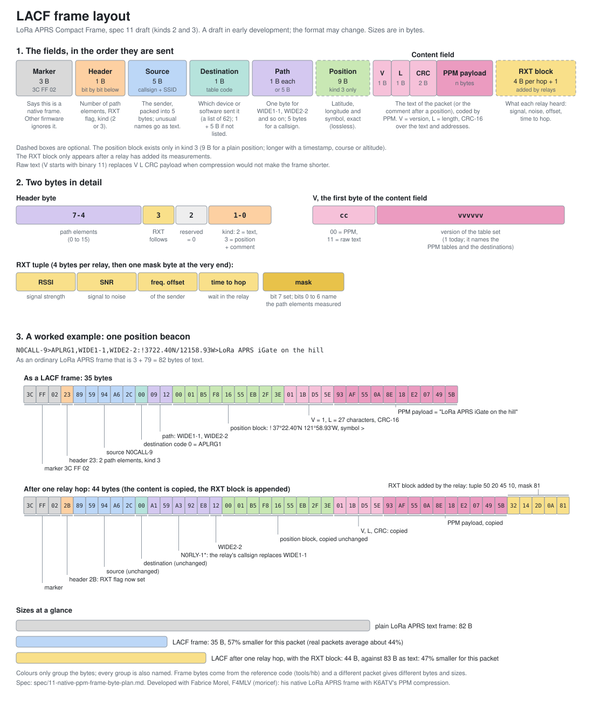

# What a LACF frame looks like

LACF (LoRa APRS Compact Frame, [spec 11](../spec/11-native-ppm-frame-byte-plan.md)) is a draft in early development, and the format may change. This page shows the layout once as a picture and once as tables, then follows one real packet byte by byte.

Every byte and bit in the picture is defined, with its values and what it does, in the [byte and bit reference](lacf-byte-reference.md). A larger PNG of the same picture is [`img/lacf-frame-layout.png`](img/lacf-frame-layout.png). The bytes in the picture come from the reference code (`tools/hb`); regenerate the picture with `python3 tools/lacf_diagram.py > docs/img/lacf-frame-layout.svg`.

## The fields, in the order they are sent

| Field | Size | What it holds |
|---|---|---|
| Marker | 3 B | `3C FF 02`: the native frame. Firmware that does not know it ignores the frame. |
| Header | 1 B | Bits 7-4: number of path elements (0 to 15). Bit 3: an RXT block follows. Bit 2: reserved, 0. Bits 1-0: kind (2 = the information field as text, PPM coded; 3 = a position block, then the comment PPM coded). |
| Source | 5 B | The sender's callsign and SSID, packed. A name that does not fit goes as a text element. |
| Destination | 1 B | A code from a list of 62 (which device or software sent the packet). 1 + 5 B when the destination is not in the list. |
| Path | 1 B each, or 5 B | One byte for `WIDEn-N`; 5 bytes for a callsign. A path that breaks the APRS `WIDEn-N` rule is not carried. |
| Position block | 9 B typical | Kind 3 only: data type, latitude, longitude, table and symbol, exactly. Longer with a timestamp, course or altitude. |
| Content field | 4 B + n | `V` (1 B), `L` (1 B), CRC-16 (2 B), then the PPM payload (n B). Raw text (`V` starts with binary 11) is used instead when PPM would not make it shorter. |
| RXT block | 4 B per hop + 1 | Added by relays only: one tuple per relay (RSSI, SNR, frequency offset, time to hop), then a mask byte. |

`V` is two bits of content coding (`00` = PPM, `11` = raw text) and six bits naming the table set (1 today), which also names the destination list. The CRC-16 covers the text, the kind bits, `V` and the source and destination, but not the path, which relays change.

## The worked example

The packet, as ordinary text (79 characters, 82 bytes with the 3-byte LoRa APRS prefix):

    N0CALL-9>APLRG1,WIDE1-1,WIDE2-2:!3722.40N/12158.93W>LoRa APRS iGate on the hill

As a LACF frame (35 bytes, 57% smaller for this packet; the average on real packets is about 44%, because this one has a long, predictable comment):

| Bytes | Field | Meaning |
|---|---|---|
| `3C FF 02` | marker | native frame |
| `23` | header | binary `0010 0011`: 2 path elements, no RXT block, kind 3 |
| `89 59 94 A6 2C` | source | `N0CALL-9` |
| `00` | destination | code 0 = `APLRG1` |
| `09` | path element | `WIDE1-1` |
| `12` | path element | `WIDE2-2` |
| `00 01 B5 F8 16 55 EB 2F 3E` | position block | data type `!`, 37°22.40'N, table `/`, 121°58.93'W, symbol `>` |
| `01` | V | PPM content, table set 1 |
| `1B` | L | 27 characters of text follow in coded form |
| `D5 5E` | CRC-16 | `0x5ED5`, low byte first |
| `93 AF 55 0A 8E 18 E2 07 49 5B` | PPM payload | `LoRa APRS iGate on the hill` in 10 bytes |

After one relay hop (44 bytes): the relay changes the front of the frame and copies everything else byte for byte.

| Bytes | What changed |
|---|---|
| `2B` | header: the RXT flag (bit 3) is now set |
| `A1 59 A3 92 E8` | path: `N0RLY-1*` (the relay's callsign, used) replaces `WIDE1-1`, so 4 bytes longer |
| `12` | path: `WIDE2-2`, unchanged |
| position block, V, L, CRC, payload | copied, not touched |
| `32 14 2D 0A` + `81` | RXT block, added at the end: the relay's tuple (50, 20, 45, 10) and the mask (bit 7 is a marker; bit 0 says path element 0 was measured), 5 bytes |

That is 35 + 4 + 5 = 44 bytes, against 83 bytes as text after the same hop (47% smaller).

These sizes are for this one packet; the averages measured on real packets are in the [README](../README.md) and in [`hybrid-savings-and-timing.md`](hybrid-savings-and-timing.md).

## Credit

LACF is developed together with Fabrice Morel, F4MLV (moricef): it combines his native LoRa APRS frame and code with K6ATV's PPM compression. RXT was created by Jon, N7UV.
